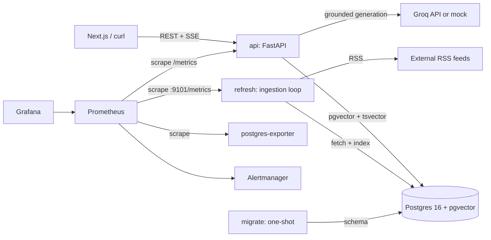

# Architecture

## Runtime topology



Compose startup order is explicit:

1. `postgres` becomes healthy.
2. `migrate` applies the idempotent baseline and pending SQL migrations, then exits 0.
3. `api` and `refresh` start only after `migrate` succeeds.
4. Prometheus, Grafana, Alertmanager and postgres-exporter run alongside them.

## Components

| Component | Responsibility | Failure boundary |
|---|---|---|
| `api` | REST/SSE serving, validation, retrieval orchestration, cache, generation | One process; a crash is restarted by Compose |
| `refresh` | RSS fetch, upsert, index sync, run history | Advisory lock prevents overlapping runs; per-feed isolation |
| `postgres` | Articles, chunks, vectors, parents, chat, cache, ingestion history | Single primary; no automatic failover |
| `migrate` | Reproducible schema changes before app start | Exits non-zero, blocking API start |
| `prometheus` | Scrapes API, refresh worker, and Postgres exporter; evaluates rules | Monitoring is separate from serving |
| `alertmanager` | Routes alerts | Local receiver only until a pager is configured |
| `grafana` | Provisioned dashboards | Read-only provisioning from repo |
| `postgres-exporter` | Database-level metrics | Optional for request serving |
| `mock-groq` / `api-mock` | Load tests and upstream failure drills | Load-test profile only |

## Request path

### Non-streaming `/ask`

1. Pydantic validates query, `k`, topic and session ID.
2. Exact normalized cache lookup; then vector cache lookup (>0.92 similarity).
3. Cache miss: query expansion + embedding.
4. Parallel pgvector and tsvector search.
5. RRF fusion with source weights and temporal decay.
6. Cross-encoder rerank; top-k deduplicated parents fetched in **one** query.
7. Groq generation with bounded retries, model fallback and circuit breaker.
8. Chat/cache persistence; response includes per-stage latency breakdown.

### Streaming `/ask/stream`

Same retrieval and generation path, then:

```text
event: sources
event: token (repeated)
event: metrics
event: done
```

A producer thread reads the synchronous Groq stream and places tokens on a
bounded queue. The async response loop enforces:

- client-disconnect detection (`request.is_disconnected()`);
- a heartbeat every `SSE_HEARTBEAT_SECONDS` when no token arrives;
- a hard `SSE_MAX_DURATION_SECONDS` ceiling;
- active-stream and disconnect metrics;
- persistence only for completed, non-disconnected streams.

## Data model

| Table | Purpose |
|---|---|
| `articles` | Canonical article records and content hashes |
| `article_chunks` | 400-char children + 1024-dim embeddings (HNSW) |
| `parent_docs` | 1500-char context passages linked by `(article_id, parent_index)` |
| `chat_messages` | Per-session conversation history |
| `semantic_cache` | Exact/vector answer cache with TTL |
| `ingestion_runs` | One row per refresh run, including failures |
| `ingestion_feed_runs` | Per-feed outcome for each run |
| `schema_migrations` | Applied migration versions |

## Reliability controls

- Lazy connection pool: importing the app never opens a connection.
- Bounded pool acquisition, `statement_timeout=5s`, `hnsw.ef_search=40`.
- Readiness is false when either DB or models are unavailable.
- Groq calls have explicit client timeout, bounded attempts, jittered backoff,
  per-key cooldown and a closed/open/half-open circuit breaker.
- Ingestion uses `asyncio.gather(return_exceptions=True)` and per-entry DB
  error isolation. A restarted worker marks abandoned `running` runs as
  `interrupted`.
- Indexing replaces each article in a transaction; a crash cannot leave a
  half-indexed article.
- SSE has disconnect detection, heartbeat behavior, and a counter that includes
  generator-close disconnects.
- Ingestion freshness is scraped from the worker process, not inferred from an
  unset API gauge. Readiness and ingestion alert expressions use job filters to
  avoid cross-process metric collisions.

## Intentional constraints

- Single API process by default (`UVICORN_WORKERS=1`). ONNX models are loaded
  per process; more workers increase memory linearly.
- Groq key state and the optional rate limiter are in-process. Multi-replica
  coordination needs a shared store (Postgres/Redis).
- No Kubernetes/Terraform in this milestone. Docker Compose is the deployment
  unit until the verification gates pass.
- No TLS termination inside the stack. A reverse proxy/load balancer must
  provide TLS and request-size limits.
